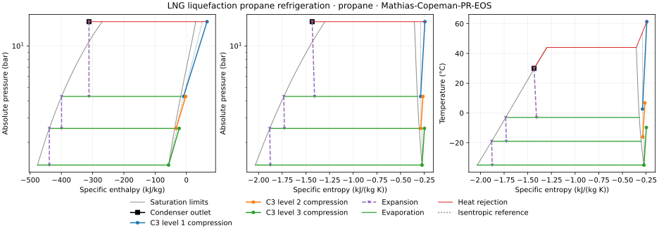

`RefrigerationSystem` is a process unit that models an industrial vapour-compression refrigeration
plant and connects it to the flowsheet it serves. Every state point is calculated from the
refrigerant equation of state; nothing is scaled from a Carnot reference.

**Location:** `neqsim.process.equipment.refrigeration`

## Contents

- [Which model to use](#which-model-to-use)
- [What the cycle contains](#what-the-cycle-contains)
- [Gas chilling example](#gas-chilling-example)
- [Two-stage ammonia with flash inter-cooling](#two-stage-ammonia-with-flash-inter-cooling)
- [Cascade systems](#cascade-systems)
- [Integration with the flowsheet](#integration-with-the-flowsheet)
- [Refrigerants and property accuracy](#refrigerants-and-property-accuracy)
- [Results](#results)
- [Limits](#limits)

## Which model to use

| Need | Class |
|------|-------|
| Early screening from a duty and two temperatures | `neqsim.process.util.utilitydesign.RefrigerationCycle` (Carnot COP times an efficiency factor) |
| Compressor power, flows, discharge temperatures and stage sizing for a pure-refrigerant plant | `RefrigerationSystem` (this page) |
| Mixed-refrigerant liquefaction (SMR, DMR, C3MR) | `neqsim.process.lng.LNGProcessBuilder`, see [LNG liquefaction](../lng_liquefaction) |

`RefrigerationSystem.getCarnotFraction()` returns the value to pass to
`RefrigerationCycle.setCycleEfficiency` when the screening model has to reproduce a rigorous cycle.
Measured on 2026-11-26 for a single-stage cycle at -35 C evaporating, 35 C condensing and 0.75
isentropic efficiency: propane 0.514, propene 0.518, R134a 0.520, ammonia 0.554. A flash economizer
at the geometric-mean pressure raises these to 0.611, 0.607, 0.617 and 0.579. The screening default
of 0.55 therefore fits a single-stage cycle and is conservative for an economized one.

## What the cycle contains

The plant has one condenser and any number of evaporating temperature levels. Each level has one
compressor stage; the coldest stage discharges into the next warmer level and the warmest stage
discharges to the condenser.

| Feature | Setting | Default |
|---------|---------|---------|
| Liquid expansion | `setEconomizerType(FLASH_TANK \| NONE)` | `FLASH_TANK`: a flash vessel at every level, flash gas goes to that level's stage |
| Inter-stage cooling | `setInterstageCooling(NONE \| FLASH_INTERCOOLER)` | `NONE`: discharge mixes with the next level's vapour |
| Condensing temperature | `setCondensingTemperature(t, unit)` or `setCondenserCoolingMedium(supply, return, approach, unit)` | 35 C |
| Subcooling, condenser pressure drop | `setSubcooling(K)`, `setCondenserPressureDrop(bar)` | 0 |
| Stage efficiency | `setIsentropicEfficiency(eta)`, or per level `level.setIsentropicEfficiency(eta)` | 0.75 |
| Evaporator superheat, suction line loss | `level.setSuperheat(K)`, `level.setSuctionPressureDrop(bar)` | 0 |
| Driver efficiency for electrical power | `setDriverEfficiency(eta)` | 0.95 |

A level without loads is an economizer stage. `addGeometricMeanEconomizer(name)` adds one at the
geometric mean of the condensing pressure and the coldest evaporating pressure, which gives equal
pressure ratios over two stages.

With `FLASH_TANK`, evaporators are fed with saturated liquid from their level's vessel (flooded or
kettle evaporators). With `NONE`, every evaporator is fed directly from the condenser liquid through
its own valve, which is the side-load arrangement without economizing.

With `FLASH_INTERCOOLER`, the discharge of a colder stage is bubbled through the liquid of the next
vessel and leaves saturated. This is the open flash inter-cooler of two-stage ammonia plants; it
requires `FLASH_TANK`.

The cycle is closed analytically. No recycle iteration is needed, and the energy balance
(refrigeration duty plus shaft power minus condenser duty) closes to round-off; read it with
`getEnergyBalanceResidual()`.

## Gas chilling example

Two chillers cool a gas stream and a propane plant with two levels serves them. The evaporating
temperature of each level follows the chiller outlet temperature minus a 5 K approach, and the
condensing temperature follows the cooling water.

```java
SystemInterface gas = new SystemSrkEos(298.15, 60.0);
gas.addComponent("methane", 0.85);
gas.addComponent("ethane", 0.08);
gas.addComponent("propane", 0.05);
gas.addComponent("n-butane", 0.02);
gas.setMixingRule("classic");

Stream feed = new Stream("feed gas", gas);
feed.setFlowRate(100000.0, "kg/hr");
feed.setTemperature(30.0, "C");
feed.setPressure(60.0, "bara");
Cooler warmChiller = new Cooler("warm chiller", feed);
warmChiller.setOutTemperature(273.15 + 5.0);
Cooler coldChiller = new Cooler("cold chiller", warmChiller.getOutletStream());
coldChiller.setOutTemperature(273.15 - 25.0);

RefrigerationSystem refrigeration = new RefrigerationSystem("propane refrigeration");
refrigeration.setRefrigerant("propane");
refrigeration.setCondenserCoolingMedium(20.0, 30.0, 8.0, "C"); // supply, return, approach
refrigeration.setSubcooling(3.0);
refrigeration.setIsentropicEfficiency(0.78);
refrigeration.addLevel("MP", 0.0, "C").setTemperatureFromLoads(5.0).addCooler(warmChiller);
refrigeration.addLevel("LP", -30.0, "C").setTemperatureFromLoads(5.0).addCooler(coldChiller);

ProcessSystem process = new ProcessSystem();
process.add(feed);
process.add(warmChiller);
process.add(coldChiller);
process.add(refrigeration);
process.run();

double dutyKW = refrigeration.getRefrigerationDuty("kW");
double powerKW = refrigeration.getCompressorPower("kW");
double condenserKW = refrigeration.getCondenserDuty("kW");
double cop = refrigeration.getCOP();
double circulation = refrigeration.getRefrigerantCirculation("kg/hr");
double coolingWater = refrigeration.getCoolingMediumFlow("tonnes/hr");
List<String> warnings = refrigeration.getWarnings();
String json = refrigeration.toJson();
```

Result: 5192 kW of chilling (1911 kW at 0 C, 3280 kW at -30 C) needs 1827 kW of shaft power, a COP
of 2.84, with 70.7 t/h of propane circulating and 7019 kW rejected to 604 t/h of cooling water. The
MP stage takes 1241 kW at 7146 m3/h suction volume and the LP stage 586 kW at 9043 m3/h. Without the
flash vessels (`EconomizerType.NONE`) the same duty needs 2100 kW.

Changing a chiller outlet temperature and running the process again moves the level temperature,
the duty and the compressor power together.

## Two-stage ammonia with flash inter-cooling

```java
RefrigerationSystem ammonia = new RefrigerationSystem("ammonia plant");
ammonia.setRefrigerant("R717");
ammonia.setCondensingTemperature(35.0, "C");
ammonia.setIsentropicEfficiency(0.75);
ammonia.addLevel("freezer", -30.0, "C").addFixedDuty("blast freezers", 1000.0, "kW");
ammonia.addGeometricMeanEconomizer("intermediate vessel");
ammonia.setInterstageCooling(RefrigerationSystem.InterstageCooling.FLASH_INTERCOOLER);
ammonia.run();
double twoStageCop = ammonia.getCOP();
double highStageDischargeC = ammonia.getStages().get(0).getDischarge().getTemperature() - 273.15;
double lowStageSweptVolume = ammonia.getStages().get(1).getSuctionVolumeFlow(); // m3/hr
```

For 1000 kW at -30 C and 35 C condensing with 0.75 isentropic efficiency:

| Arrangement | Shaft power (kW) | COP | High-stage discharge (C) |
|-------------|------------------|-----|--------------------------|
| Single stage | 471 | 2.13 | 199 |
| Two stages, flash economizer | 452 | 2.21 | 194 |
| Two stages, flash economizer and flash inter-cooler | 422 | 2.37 | 107 |

The inter-cooler is what makes two-stage ammonia practical: it brings the discharge temperature
from about 195 C to about 107 C, and the plant needs 10 % less power than a single stage.

## Cascade systems

A carbon dioxide system has to condense below its critical temperature of 31 C, so it is cascaded
against a warmer system. `RefrigerationLoad.cascadeCondenser` makes the condenser of the cold system
a load on a level of the warm one.

```java
RefrigerationSystem co2 = new RefrigerationSystem("CO2 low stage");
co2.setRefrigerant("CO2");
co2.setCondensingTemperature(-10.0, "C");
co2.addLevel("freezer", -45.0, "C").addFixedDuty("freezers", 1000.0, "kW");

RefrigerationSystem highStage = new RefrigerationSystem("ammonia high stage");
highStage.setRefrigerant("ammonia");
highStage.setCondensingTemperature(35.0, "C");
highStage.addLevel("cascade condenser", -15.0, "C").addLoad(RefrigerationLoad.cascadeCondenser(co2));

ProcessSystem cascade = new ProcessSystem();
cascade.add(co2);
cascade.add(highStage);
cascade.run();
double cascadeCop = co2.getRefrigerationDuty() / (co2.getCompressorPower() + highStage.getCompressorPower());
```

The cold system needs 262 kW and the warm system 401 kW, an overall COP of 1.51. The 5 K between
the CO2 condensing temperature and the ammonia evaporating temperature is the cascade condenser
approach; `getWarnings()` reports it when it falls below `setMinimumApproach` (2 K by default).

## Integration with the flowsheet

### Loads

A level reads its loads on every run.

| Load | How to add it | Process temperature |
|------|---------------|---------------------|
| Process cooler (`Cooler` or any `Heater` that cools) | `level.addCooler(cooler)` | cooler outlet temperature |
| Fixed duty | `level.addFixedDuty(name, value, unit)` | not known |
| Fixed duty with a process temperature | `level.addLoad(RefrigerationLoad.fixed(name, dutyW, temperatureK))` | as given |
| Condenser of a colder refrigeration system | `level.addLoad(RefrigerationLoad.cascadeCondenser(system))` | its condensing temperature |
| Anything else | implement `RefrigerationLoad` | as implemented |

`level.setTemperatureFromLoads(approachK)` makes the evaporating temperature follow the coldest
process temperature of the level's loads. With a fixed level temperature, `getWarnings()` lists
every load whose process temperature is closer to the refrigerant than the minimum approach.

### Execution order

The refrigeration system reports the equipment behind its loads through
`ProcessEquipmentInterface.getSignalSources()`. Graph-based execution, the default for a flowsheet
without recycles or adjusters, therefore solves the coolers and colder cascade systems first,
whatever the order in which the units were added. A flowsheet that runs sequentially (one with
`Recycle` or `Adjuster` units) uses insertion order: add the refrigeration system after the
equipment it serves.

### Power, heat rejection and compressor detail

| Interface | Use |
|-----------|-----|
| Energy port `RefrigerationSystem.SHAFT_POWER_PORT` | Total shaft power to an `EnergyStream` or power bus: `connectEnergyStream(SHAFT_POWER_PORT, stream)` |
| Energy port `RefrigerationSystem.CONDENSER_HEAT_PORT` | Heat rejected at the condenser |
| `addCondenserTo(coolingWaterSystem, approachK)` | Registers the condenser duty on a `CoolingWaterSystem` |
| `createSuctionStream(stageIndex)` | A `Stream` at a stage suction, the inlet for a detailed `Compressor` with a chart, driver or mechanical design. It is a snapshot of the last run |
| `UtilitySystemDesigner.fromProcessSystem(process)` | Counts the condenser duty as the cooling demand and the compressor power as a shaft load. Coolers bound to the refrigeration system are not counted as cooling-water or air-cooler demands |

## Refrigerants and property accuracy

`setRefrigerant(name)` accepts a NeqSim component name or an ASHRAE designation (R717, R744, R290,
R1270, R1150, R170, R600, R600a, R134a, R12) and selects the equation of state:

| Refrigerant | Model selected |
|-------------|----------------|
| Ammonia | `SystemAmmoniaEos`, the reference equation |
| CO2 | `SystemGERG2008Eos` |
| All others | `SystemPrMathiasCopeman`: Peng-Robinson with the Mathias-Copeman temperature function. A component without Mathias-Copeman parameters in the database (propene, ethylene, R12) gets the standard Peng-Robinson function |

The choice rests on this measurement of 2026-11-26. Errors are in saturation pressure and latent
heat. The yardstick is NIST saturation data, the Tillner-Roth and Baehr (1994) vapour-pressure
equation for R134a, and for ammonia the reference equation at 220 to 380 K.

| Refrigerant | Points | Selected model | Plain Peng-Robinson, for comparison |
|-------------|--------|----------------|-------------------------------------|
| Ammonia | -33.3 C, 30 C | below 0.1 %, below 0.1 % | up to +1.3 %, up to +4 % |
| CO2 | -40 C, -20 C | below 0.1 %, below 0.1 % | up to -1.6 %, up to +1.6 % |
| Propane | -40, 0, 30, 50 C | within 0.5 %, within 0.7 % | within 0.4 % and 0.6 % here, but +2.2 % in pressure at -70 C |
| Isobutane | -11.8 C | 0.0 %, +0.2 % | +2.1 %, -1.2 % |
| n-Butane, ethane | boiling point | within 0.5 %, within 0.5 % | within 0.7 %, within 0.4 % |
| R134a | -40, -26.1, 0, 30, 60 C | within 0.3 %, +0.6 to +2.0 % | within 0.6 %, -0.2 to +2.3 % |
| R12 | -29.8, 0, 30 C | within 0.5 %, +0.1 % at the boiling point | same model |
| Propene | -47.6 C, 30 C | +0.7 %, +0.1 % in pressure; -0.7 % in latent heat | same model |
| Ethylene | -103.8 C | +1.5 %, -1.2 % | same model |

A cubic equation with a fitted temperature function still carries its vapour-volume error into the
latent heat. That is the 2 % for R134a above 0 C, and for ammonia it reaches +4.5 % with 3 % low
vapour density, which is why ammonia uses the reference equation.

The ideal R134a cycle between 0.14 and 0.8 MPa in Cengel and Boles has a COP of 3.97; the model
reproduces it within 3 %.

### Database parameters corrected for refrigerants

These corrections are in the component database and apply to every NeqSim model that reads the
parameter, not only to refrigeration.

| Component | Parameter | Before | Now |
|-----------|-----------|--------|-----|
| Ammonia | Ideal-gas heat capacity | 16 % high at 200 K, 25 % at 300 K, 42 % at 500 K | Poling, Prausnitz and O'Connell polynomial, within 0.4 % of the reference equation from 200 to 500 K and of JANAF at 1000 K |
| Ammonia | Mathias-Copeman parameters for SRK (`SystemSrkMathiasCopeman`, `SystemPsrkEos`) | The published PSRK constants of methanol; saturation pressure 70 % low | Fitted to the reference equation, within 0.3 % from 220 to 380 K |
| Ammonia | Mathias-Copeman parameters for Peng-Robinson | Saturation pressure 76 % low | Fitted to the reference equation, within 0.2 % from 220 to 380 K |
| R134a | Critical temperature, critical pressure, acentric factor, molar mass, boiling point | 100.85 C, 40.7 bara, 0.332, 102.0, -26.55 C | 101.06 C, 40.593 bara, 0.32684, 102.032, -26.07 C |
| R134a | Mathias-Copeman parameters for SRK and Peng-Robinson | SRK: the PSRK constants of CO2, pressure 38 % high. Peng-Robinson: none | Fitted to the Tillner-Roth and Baehr equation, within 0.5 % from 215 to 360 K |
| R134a, R12 | Ideal-gas heat capacity | All zero; compressor calculations failed | Retains the R134a ideal-gas correlation from NeqSim 3.30.0 and adds the Reid, Prausnitz and Poling correlation for R12 |
| R12 | Critical temperature, critical pressure, acentric factor, molar mass, boiling point | 111.85 C, 41.4 bara, 0.176, 121.0, -30.15 C | 111.97 C, 41.361 bara, 0.17948, 120.913, -29.75 C |
| R12 | Mathias-Copeman parameters for SRK | The PSRK constants of CO2 | Removed; the standard SRK temperature function applies |

Results for ammonia with a cubic or CPA equation of state change with the heat-capacity
correction: enthalpies, heat duties and compressor discharge temperatures. The ammonia critical
constants are unchanged, because the CPA parameters were fitted with them.

### Supplying another model

`RefrigerantFluid.of(name, fluid)` wraps any single-component NeqSim fluid. The saturation states
it returns are checked: liquid and vapour must be distinct phases with equal Gibbs energy. A model
that fails is rejected with an explanation. This matters for GERG-2008 with propane, ethane, the
butanes and nitrogen, where the NeqSim bubble-point flash returns a wrong pressure at high reduced
temperature (21.5 bara for propane at 314 K, where the saturation pressure is 14.3 bara). GERG-2008
agrees with the fitted Peng-Robinson model within 0.2 % for CO2 between 0.70 and 0.95 of the
critical temperature, and is correct for propane at 0 C.

## Results

| Method | Returns |
|--------|---------|
| `getRefrigerationDuty(unit)`, `getCompressorPower(unit)`, `getCondenserDuty(unit)`, `getElectricalPower(unit)` | Totals |
| `getCOP()`, `getCarnotCOP()`, `getCarnotFraction()` | Performance. The Carnot reference works between each level and the condensing temperature |
| `getRefrigerantCirculation(unit)`, `getCoolingMediumFlow(unit)` | Flows in kg/sec, kg/min, kg/hr or tonnes/hr |
| `getCondensingPressure()`, `getCondenserOutlet()` | Condenser state |
| `getStages()` | Per stage, warmest first: suction and discharge `RefrigerantState`, mass flow, suction volume flow, pressure ratio, power |
| `getLevels()`, `getLevel(name)` | Per level: pressure, duty, evaporator flow, flash gas flow, feed flow and feed vapour fraction |
| `getWarnings()` | Loads too cold for their level, and wet compressor suction |
| `getEnergyBalanceResidual()` | Duty plus power minus condenser duty, in W |
| `toJson()`, `toResultsMap()` | All of the above, schema version 1.0 |

`validateSetup()` reports a missing refrigerant or level, a level at or above the condensing
temperature, a condensing temperature at or above the critical temperature, and flash inter-cooling
without flash vessels. `run()` throws an `IllegalStateException` carrying the same message.

## Heat recovery and heat pumps

Use the same vapour-compression system for a heat pump. Specify the available
evaporator load and the heating-medium temperatures at the condenser. This
example warms returning water from 35 to 50 °C and assumes full condenser
heat recovery. Method arguments follow the flow direction through the condenser
(inlet 35 °C, outlet 50 °C). A 5 K approach means condensation at 55 °C.

```java
RefrigerationSystem pump = new RefrigerationSystem("water heating");
pump.setRefrigerant("ammonia");
pump.setCondenserCoolingMedium(35.0, 50.0, 5.0, "C");
pump.setCoolingMediumHeatCapacity(4180.0); // mean water Cp, J/(kg K)
pump.setDriverEfficiency(0.90);
pump.addLevel("source", 5.0, "C").addFixedDuty("recovered heat", 100.0, "kW");
pump.run();
double deliveredKW = pump.getCondenserDuty("kW");
double electricalKW = pump.getElectricalPower("kW");
double heatingCOP = pump.getHeatingCOPElectrical();
double waterKgPerSec = pump.getCoolingMediumFlow("kg/sec");
```

The model delivers 129.65 kW to 2.07 kg/s of water and draws 32.94 kW of
electricity, giving a heating COP of 3.94. The fluid energy balance uses shaft
power. Motor losses are outside the refrigerant circuit. With partial heat
recovery, divide the useful heat actually delivered by electrical input and
include pumps and fans when reporting plant COP. The source duty in this example
is specified. Bind a real source cooler with `addCooler` to follow its duty.

| Medium or duty | Inputs and property basis |
|---|---|
| Water heated or cooled sensibly | Use condenser-medium inlet/outlet temperature, approach (K), and mean mass heat capacity in J/(kg K). The unit defaults to 4186. Use reference-water enthalpies at actual pressure over a wide temperature span. |
| Once-through seawater | Register the solved condenser using `addCondenserTo` on a fresh `CoolingWaterSystem`. Set its supply/return temperatures, pressure (bara), reference salinity (g/kg solution), system pressure drop (bar), pump efficiency and zero tower-fan fraction. It calculates flow from the reference enthalpy difference. [Water and seawater models](reference_cooling_water) |
| Glycol/water, brine or thermal oil | Supply composition and operating pressure. Use a validated mean Cp for a narrow, single-liquid range or size the medium flow from its own model or tabulated enthalpy rise. Check freezing and boiling margins for that concentration. |
| Evaporator source or a phase-changing utility | Bind the process cooler and use its enthalpy duty. Specify the temperature approach separately. A constant-Cp liquid calculation does not represent latent heat. |

As a check on the choice of cooling medium, a 1 MW condenser heating water
from 20 to 30 °C at 4 bara requires 23.92 kg/s of fresh water or 25.00 kg/s
of seawater at 35 g/kg reference salinity in `CoolingWaterSystem`. For the
heat-pump example, the reference fresh-water calculation gives 2.069 kg/s at
4 bara, compared with 2.068 kg/s using the specified mean heat capacity.

For a service with known supply and return enthalpies, `UtilityEnergyBus`
accepts two `ThermalUtilityState` values with temperature (K), absolute pressure (Pa)
and specific enthalpy (J/kg). Its `getMassFlowForDuty` uses the enthalpy
difference. This also supports hot-oil and steam service when the project
supplies appropriate fluid properties and states. A utility grade label
alone does not supply a fluid composition or a property correlation.

## Plot the solved process

Use pressure–enthalpy to read specific work, evaporation duty and valve
enthalpy; pressure–entropy to compare each compression with an isentropic
reference; and temperature–entropy to see condensation and evaporation.
The calculation and the saturation limits must use the same refrigerant
and property reference. Connections between reported states are schematic.
A separate T–Q diagram shows hot and cold composites of a solved LNG exchanger.



From a NeqSim checkout with Matplotlib 3.7+ and NumPy, pass the live solved
objects from the Java/Python bridge to the plotting helper:

```python
from runpy import run_path

plots = run_path(".github/skills/neqsim-utility-design/scripts/refrigeration_diagrams.py")
plots["plot_cycle"](pump).savefig("heat-pump.svg")
plots["plot_exchanger"](main_exchanger).savefig("temperature-duty.svg")
```

Use [the C3MR comparison](../lng_liquefaction#compare-one-and-three-propane-levels)
for a complete train example.

## Limits

- Single-component refrigerants only. A mixture is rejected; use the dominant component, or
  `LNGProcessBuilder` for mixed-refrigerant cycles.
- Subcritical condensing only. Transcritical CO2 is not modelled; cascade it.
- Steady state. Evaporators and the condenser are heat balances with a temperature approach, not
  rated exchangers, and compressor stages use a fixed isentropic efficiency. For a performance
  chart, feed `createSuctionStream` to a `Compressor`.
- Refrigerant-side pressure drop is limited to the suction lines and the condenser.

## Related documentation

- [Compressors](compressors) for detailed compressor models
- [Reference water and seawater cooling](reference_cooling_water) for the condenser cooling side
- [Energy streams](../energy_streams) for energy ports and buses
- [Graph-based simulation](../processmodel/graph_simulation) for execution order
- [LNG liquefaction](../lng_liquefaction) for mixed-refrigerant cycles
