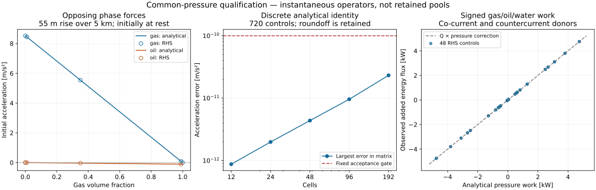
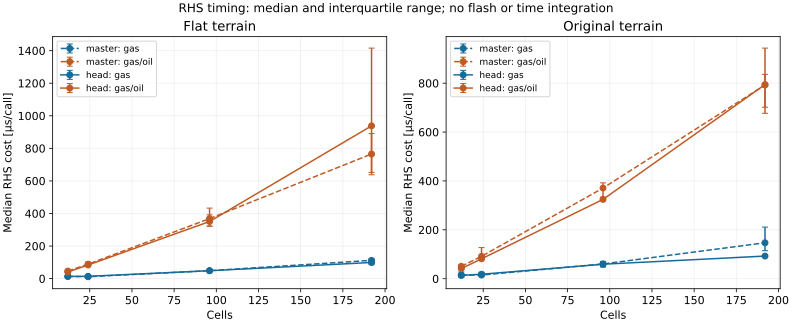

# Interior hydrostatic pressure reconstruction

## Scope and provenance

This public analytical fixture qualifies the finite-volume interior pressure/body-force balance
implemented by `TwoFluidConservationEquations`. It was derived from the independent
`GravityInteriorEnergyAudit` attached to the durable #3298 campaign record on 2026-10-31. That
audit reproduced the unmodified-master limitation before the production operator was changed.
It is an analytical numerical benchmark, not experimental or field qualification.

The fixture constructs an exact piecewise-constant hydrostatic state. For cell `i`,

`pFace[i+1] = pFace[i] - rho[i] * g * (zFace[i+1] - zFace[i])`

and the stored cell pressure is the average of its two bounding face pressures. The production
operator reconstructs a common internal-face pressure from the adjacent conservative mixture
inertias and signed half-cell gravity heads. It applies the same correction to momentum traction,
phase-pressure diagnostics, and total-energy pressure work.

## Predeclared matrix and gates

`HydrostaticPressureReconstructionTest` executes all 90 combinations below:

- terrain: flat, affine, and the public 5 km rich-gas terrain profile;
- density: constant, smooth sinusoidal variation, and alternating 0.75/1.25 factors;
- mesh: 12, 24, 48, 96, and 192 cells;
- present phase: pure gas at 10 kg/m3 or pure oil at 800 kg/m3 before density factors.

A separately declared 45-case aqueous extension repeats the same terrain, density and mesh matrix
for pure water at 1000 kg/m3. It strengthens three-phase-path coverage without changing the
predeclared 90-case hydrocarbon basis.

Every case must satisfy all of these unchanged gates:

- maximum absolute acceleration below `1e-10 m/s2`;
- exactly zero local phase-mass rate;
- exactly zero local total-energy rate;
- one finite reconstruction diagnostic for every internal face.

The signed-work controls use actual AUSM face fluxes at -2 and +2 m/s and require the added
energy flux to equal `Q * deltaP` with the same donor density as mass transport. The absolute
comparison allowance is `5e-8 W`; this covers subtraction roundoff at an approximately 3.2 MW
total face flux and is not a conservation tolerance. A horizontal control requires an exactly
zero correction, and a transactional trial must restore the accepted diagnostic ledger exactly.

## Result and capability boundary

On the implementation head, all 90 hydrocarbon cases, all 45 aqueous-extension cases and all
signed-work, horizontal-compatibility, and rollback controls pass. The five-method class took about
0.12 seconds in the original implementation runner after compilation; this is a test-runtime observation, not a
production throughput claim.

The production change adds constant work per internal face and reuses its `N-1` diagnostic array
when the mesh size is unchanged. It does not introduce another nonlinear iteration, flash, or
per-phase history structure.

The unchanged opt-in explicit-face Tengesdal five-second gate remains failed. Against exact master
`3c1c5dda4`, the candidate changes the 16-cell 0.1 s failure time from 1.101171875 to 1.1 s, the
16-cell 0.05 s time from 1.15625 to 1.5080078125 s, and the 24-cell 0.05 s time from 0.57265625 to
0.5884765625 s. Every case still fails line search at the unchanged `1e-9` nonlinear tolerance;
the nearby-point progress is not a five-second or physical qualification claim.

The reconstruction balances total mixture momentum for a common mechanical pressure. It does not
claim that multiple stationary phases with different densities share an exact hydrostatic gradient,
does not validate a moving gas/liquid interface or a terrain pool, and does not qualify slugging,
shutdown/restart, phase-transfer rates, pigging, or commercial-simulator parity.

## Unequal-density phase-force and work extension (2026-10-31)

Production source: PR #4768 head `04473d528649e43130168f258bdc717aa3715ca9`;
unmodified comparison master `aec17276c6af57c0b0be56e8c302893bc623fb5f`.
The production conservation-equations blob is
`a650f29dec85b3ea40aa023258320108847a2919`. This extension changes tests and
evidence, with no additional production runtime path or closure parameter.

For uniform phase fractions and initially zero phase velocities, write the axial
inviscid phase force as `alpha[k] * A * (-dp/ds - rho[k] * g * sin(theta))`.
With `dp/ds = -rhoMix * g * sin(theta)`, division by present-phase inertia gives
`a[k] = (rhoMix / rho[k] - 1) * g * sin(theta)`. The weighted sum of phase forces
is zero. Different phase accelerations are consequently expected even when total
mixture momentum is balanced. This analytical limit does not prescribe a pool's
position, volume, free surface, or long-time retention.

`MultiphaseHydrostaticForceQualificationTest` executes 720 controls:

- four terrains: horizontal, 55 m rise, 55 m fall, and the original public profile;
- constant density or a fixed smooth sinusoidal density factor;
- 12, 24, 48, 96, and 192 cells over 5 km, ID 1.0148 m;
- gas fractions 0, 1e-12, 0.01, 0.35, 0.99 and 1;
- liquid water cuts 0, 0.25 and 1, with gas/oil/water reference densities 10/800/1000 kg/m3.

Endpoint repetitions also check independence from unused liquid composition.
The 48 work controls use six gas/oil/water partitions, four signed velocity
patterns (including countercurrent oil/water), inclinations -0.1/+0.1 rad, and
unequal left/right donor densities. They compare the actual energy-flux change
with `sum(alpha[k] * u[k] * A) * deltaP` and require exactly unchanged phase-mass
fluxes. The allowance is `1e-7 W + 1e-12 * abs(originalEnergyFlux)`; it covers
subtraction roundoff and was frozen before evaluation.

| Quantity | Largest observed value | Predeclared gate |
| --- | ---: | ---: |
| Phase-acceleration absolute error | 2.3198e-11 m/s2 | 1e-10 m/s2 |
| Summed mixture-force residual | 1.4297e-10 N/m | 1e-8 N/m |
| Stationary local mass / total-energy rates | exactly zero | exactly zero |
| Absent-phase momentum rate | exactly zero | exactly zero |
| Added pressure-work absolute error | 2.5924e-8 W | allowance above |
| Largest absolute added pressure work | 4752.7722 W | diagnostic, no target |

The refinement plot measures a discrete analytical identity. Its roundoff error
increases as the cell pressure difference decreases; every case remains inside
the unchanged bound. It is not transient spatial-convergence evidence.

The existing no-slip pressure-cancellation regression is extended to horizontal
and inclined controls. On an incline, equal cell pressures and varying mixture
density imply different reconstructed face pressures. Its expected correction
now uses independently calculated signed half-cell heads; the old `1e-10 N/m`
comparison and exact absent-phase checks remain unchanged.

### Reproduction and retained outputs

In a normal checkout of the published PR head, bootstrap Maven using the
`work-with-neqsim` helper, then run `./mvnw test` selecting
`HydrostaticPressureReconstructionTest`, `MultiphaseHydrostaticForceQualificationTest`
and `TwoFluidMomentumSourceConservationTest`. Test compilation supplies the audit
classes. Run the main method of `MultiphaseHydrostaticForceQualificationTest`
with the desired output directory and the normal test/dependency classpath to
write `phase-forces.csv` and `phase-work.csv` with all assertions active.
`HydrostaticPressureRhsBenchmark` takes an output CSV path. Run `plot_results.py`
beside the retained CSV files using Python 3, NumPy and Matplotlib to regenerate
the figures. This is a Java fixture and report, with no notebook execution path.

The local source tree compiled all 3622 current main Java units; cached files
were accepted only after matching current Git blob hashes. The runtime was
OpenJDK 17.0.20. The Java 8 POM compilation passed, and the new fixture also
compiled with `--release 8`. This is Java 8 source/bytecode compatibility evidence;
the local tests did not execute on a Java 8 JVM.

### Historical rich-gas ramp regression and current-master check

All five methods of `TwoFluidRichGasDragQualificationTest` passed on the candidate
(177.7 s wall time). This includes the complete prescribed 150-to-10 bara outlet
pressure ramp over 120 s on 12 and 24 cells, first oil appearance through 33 s,
and the separately declared explicit-donor signed-flow continuation. The full
120 s ramp method also passed on the unmodified comparison master in 118.336 s
wall time. These execution times are runner observations, not a controlled
production-throughput comparison.

The original ramp retains SRK/classic and the public six-component feed,
277.15 K/150 bara initial state, the original face terrain, zero seed liquid,
closed inlet and the 30 s approximate phase-relaxation closure. All requested
ramp calls advance their full intervals, with component, phase-mass and open
energy checks and no outlet backflow clamp. The test still prescribes receiver
pressure rather than a physical valve/receiver model. It does not run settling,
same-gas inlet refill or hold, nor demonstrate retained low-point pools or a
predictive hydrocarbon evaporation rate. The mixed-isothermal reference masses
in #3298 were not used as fit targets.

The separate new force-matrix assertion fails on unmodified master at the
12-cell smooth-density uphill pure-oil control: acceleration error
`0.0032325841882565446 m/s2` against the unchanged `1e-10 m/s2` gate. This is the
interior gravity-discretization defect, distinct from the already addressed
#4678 trace-phase impulse / zero-mass momentum defects. The original no-slip
pressure-cancellation test passes on that master; the updated expected face
traction is required by the intentional reconstruction in #4768.

### RHS cost protocol

The final timing protocol uses 10,000 unmeasured RHS calls per configuration,
then seven batches of 1,000 calls, in two fresh JVM forks for each source.
Execution order is master, candidate, candidate, master. Both use OpenJDK
17.0.20, `-Xbatch -Xms256m -Xmx256m`, without a coverage agent. The 16
configurations combine horizontal/original terrain, pure gas/gas-oil, and
12/24/96/192 cells. Every call executes the real `calcRHS` on the same valid
initial state. A volatile checksum retains the computed momentum rate.

This measures the finite-volume RHS including closures and allocation; it does
not measure an EOS flash, thermodynamic recovery or nonlinear integration.
The plots show median and interquartile range of all 14 final batches per
configuration. The runner is shared and not pinned to a CPU. No production
throughput guarantee or hard performance acceptance is inferred.

Earlier 1,000-warmup exploratory timings are retained in the `concurrent` and
`short` CSV files. Some overlapped with compilation or regression tests; they
are not silently substituted for the final protocol. The longer warmup reduces
JIT transients. All final forks are retained, including slower batches.

| Terrain | Gas fraction | Cells | Master median, µs | Candidate median, µs | Ratio |
| --- | ---: | ---: | ---: | ---: | ---: |
| flat | 1 | 12 | 13.388 | 13.402 | 1.001 |
| flat | 1 | 24 | 11.461 | 14.261 | 1.244 |
| flat | 1 | 96 | 48.695 | 48.428 | 0.995 |
| flat | 1 | 192 | 111.981 | 99.188 | 0.886 |
| flat | 0.35 | 12 | 46.334 | 40.541 | 0.875 |
| flat | 0.35 | 24 | 88.632 | 83.552 | 0.943 |
| flat | 0.35 | 96 | 368.343 | 350.789 | 0.952 |
| flat | 0.35 | 192 | 765.195 | 938.231 | 1.226 |
| original | 1 | 12 | 15.380 | 13.397 | 0.871 |
| original | 1 | 24 | 15.044 | 18.324 | 1.218 |
| original | 1 | 96 | 60.235 | 59.342 | 0.985 |
| original | 1 | 192 | 147.010 | 92.631 | 0.630 |
| original | 0.35 | 12 | 50.815 | 41.558 | 0.818 |
| original | 0.35 | 24 | 91.676 | 81.485 | 0.889 |
| original | 0.35 | 96 | 370.944 | 324.604 | 0.875 |
| original | 0.35 | 192 | 792.596 | 794.458 | 1.002 |

These descriptive ratios retain runner and JIT variation. No new production code
is added by this qualification extension, and the timings do not establish
whole-pipeline overhead or a universal speed bound.

### Validation receipt and documentation impact

The final local selection passed **122 JUnit methods in 20 classes**, with zero
failures, errors or skips: 85 focused mechanical/energy/transaction controls,
five slow rich-gas methods, and 32 additional closed-boundary, conservative-energy,
energy-transport, report and whole-pipe rollback methods. The independent
current-master ramp and original no-slip assertion also passed as recorded above.

The Maven helper was evaluated before Maven/Spotless. Direct Spotless apply and
its stable repeat, pre-commit, direct Spotless check, documentation search,
pre-push and whitespace checks all passed. The task-specific pre-commit executable
ran both current repository stages. Engineering coverage regenerated without a
content change. `validation.json` retains exact stage exit codes, all 122 test
identities and times, resolved setup attempts, replay and visual inspection.
`source-manifest.json` records the exercised source blobs. No full-repository or
local Java 8 JVM test result is inferred.

Documentation impact: model guide, evidence matrix and this executable public
record are updated for the additional analytical coverage and its limits.
Production APIs, routing ownership, runtime defaults, and physical prediction
claims are unchanged by this extension. #4769 retains the phase-resolved boundary
ledger ownership; no parallel boundary or solver architecture is introduced.
The full #3298 pooling/refill/evaporation acceptance remains open.
