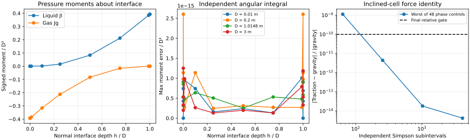

# Stratified hydrostatic pressure moments: executed numerical record

This increment supplies the phase-resolved pressure-traction geometry needed before a retained
liquid pool can be represented consistently. It is an explicit query in the existing
`GeometryCalculator`; it has no automatic transient-solver call site. **No dynamic pool-retention,
blowdown/refill/hold or hydrocarbon evaporation claim is made here.** Issues #3298, #4674 and #4675
remain open. The existing coordinator, component transport and energy owners are unchanged.

The tested unmodified default-branch base is
`b018bc708b64927890a7ba072ba806d370a86b26` (merged #4768, with #4769 phase-resolved boundary
ledgers). That base has the static depth/area reconstruction and common hydrostatic mechanical
pressure, but no phase pressure-moment query. Exact implementation and test Git blob SHAs and
SHA-256 hashes are retained in [source-manifest.json](source-manifest.json). The PR head identifies
the complete tree; the manifest identifies the exact Java sources used for the calculations.

## Definitions and scope

For pipe internal diameter $D$ and interface depth $h$ measured normal to the circular section,
let $y$ denote height above the invert and $w(y)=2\sqrt{y(D-y)}$ the chord width. The API returns
signed first moments about the interface, in m3:

$$J_l=\int_0^h(h-y)w(y)\,dy,\qquad J_g=\int_h^D(h-y)w(y)\,dy.$$

The liquid moment is nonnegative and gas moment nonpositive. Its immutable serializable result
also supplies the phase areas in m2, which satisfy $dJ_k/dh=A_k$. The hydrostatic contribution
to axial phase pressure traction is $\rho_k g\cos(\theta)J_k$ in N. The separate interface-pressure
term is $p_I A_k$. Density is constant within each phase for this static identity, gravity is
9.81 m/s2, the section is circular and the pipe segment is straight. Capillarity and waves are
excluded. The geometry calculation itself has no EOS, fluid composition, heat-transfer or rate
parameters, and does not infer them.

For a horizontal free surface in a straight segment parameterized by arclength $s$,
$dh/ds=-\tan(\theta)$, giving the finite-volume identity

$$\rho_k g\cos(\theta)[J_k(h_R)-J_k(h_L)]=-\rho_k g\sin(\theta)\int_0^L A_k(h(s))\,ds.$$

This identity concerns the hydrostatic parts only; it does not include all interface-pressure
and wall contributions required in a momentum equation. Wiring the moments into existing
phase momentum and conservative energy work is a separate numerical/model boundary. Common
mixture pressure alone does not make two phases with different densities stationary.

The implementation integrates the minority segment using a positive 16-point Gauss rule after
$y=h t^2$ removes the square-root endpoint. The other moment follows from
$J_l+J_g=(h-D/2)\pi D^2/4$. Exactly absent phases have zero area and moment; no inventory is
seeded, deleted or clipped. Nonfinite/out-of-range inputs and unrepresentable positive trace
moments reject explicitly. Very small or large dimensions outside representable double
precision are not supported. Finite but arbitrary dimensions are not a physical validation range.

## Fixed gates and executed controls

The gates were recorded in #3298 comment 6544469566 before editing. They were not changed after
seeing results: each moment error must be at most `1e-14 D³ + 1e-10 |reference|`; area derivatives
must agree within `1e-7 D²`; final gravity/traction errors must be at most
`1e-12 N + 1e-10 |gravity force|`.

| Control | Inputs / independent reference | Result |
| --- | --- | --- |
| Moments, both phases | 52 sections: D = 0.01, 0.2, 1.0148, 3 m; 13 depth fractions from exact absence to fullness, including 1e-14 traces. Independent angular Simpson integration with 4096 subintervals | Maximum absolute error / D³ = 2.6021e-15; fixed gates pass |
| Analytical limits | Half section Jl = D³/12, Jg = −D³/12; full liquid Jl = πD³/8; complementary sections; exact absent phase | Pass |
| Trace limits | h/D = 1e-14; Jl / (h² sqrt(hD)) → 8/15 and Al / (h sqrt(hD)) → 4/3 | Positive trace preserved; limits pass at 1e-10 absolute |
| Area derivatives | Four diameters, six ordinary depths; central difference step 1e-5 D | Both phase derivatives pass fixed 1e-7 D² gate |
| Finite-volume force | Four diameters, ±0.03 rad, normal depths 0.87D↔0.17D, L = 0.7D / abs(tan θ); densities 10/800/1000 kg/m3; each phase checked separately | 48 comparisons per quadrature refinement; final relative residual ≤4.1936e-15 |
| State/API contract | Immutable result serialization and invalid/nonrepresentable geometry | Pass |

[Moments](moments.csv) retain all 52 sections and both signed references.
[Forces](forces.csv) retain all 192 phase comparisons, including the coarse grids that do not
meet the final gate. Refinement changes only the independent integral of the axial phase area;
it is **not a dynamic pipeline mesh/time refinement study**.

| Independent Simpson subintervals | Maximum relative gravity/traction residual |
| --- | ---: |
| 64 | 1.1195e-9 |
| 256 | 4.3971e-12 |
| 1024 | 1.8059e-14 |
| 4096 | 4.1936e-15 |



All three panels were visually inspected from the generated PNG. Signed moments, dimensional
normalization, reference errors and refinement are readable, with no clipped axes or legends.
The SVG and PNG come from the same [plotting source](plot_results.py), with deterministic SVG
metadata. [summary.json](summary.json) retains the numerical summary and predeclared gates.

## Runtime, compatibility and regressions

The retained [timing.csv](timing.csv) measures seven batches of 100,000 explicit queries after
three equal warm-up batches, varying depth over 997 values at D = 1.0148 m. OpenJDK 17.0.20
reported 171.19 / 241.69 / 629.89 ns per query (minimum / median / maximum). This hot-loop
measurement includes JIT/scalar-replacement effects and shared-runner variability; it is not
an allocation benchmark, end-to-end simulation speedup or a performance guarantee. No existing
calculation invokes the new method, so no quadrature loop is added to an ordinary timestep.

Both changed Java files compiled with `javac --release 8`. Tests ran on Java 17, not on a Java 8
runtime. The focused matrix passed 16 tests (10 existing static-cell tests plus six new tests).
The broader matrix passed 83 tests in 12 classes, including phase appearance, passive drag,
closed/interior pressure, unequal-density forces, component outlets, energy and rollback.
Formatting, documentation, generated coverage and hook results are recorded in
[validation.json](validation.json); only completed commands are marked passed there.

An initial local static-cell test run failed because the existing `reference.csv` fixture was
missing from the partial local cache. Fetching the unchanged file from the exact base resolved
that workspace defect; no fixture tolerance or model code was changed to resolve it.

## Reproduce

From the repository root, use the current Maven bootstrap when working in a restricted runtime,
then run:

```bash
python3 devtools/run_spotless.py apply
./mvnw -q -Dtest=StratifiedPressureMomentsTest,HydrostaticCellGeometryTest test
./mvnw -q dependency:build-classpath -Dmdep.outputFile=target/pressure-moments-classpath.txt
java -cp "target/test-classes:target/classes:$(cat target/pressure-moments-classpath.txt)" \
  neqsim.process.equipment.pipeline.twophasepipe.closure.StratifiedPressureMomentsTest \
  src/test/resources/neqsim/process/equipment/pipeline/hydrostatic-pressure-moments
python3 src/test/resources/neqsim/process/equipment/pipeline/hydrostatic-pressure-moments/plot_results.py
```

Timing will vary; the deterministic physics CSVs and analytical assertions should reproduce.
No notebook, thermodynamic-reference fitting or experimental evaporation dataset is involved.

## Remaining engineering gates

Couple phase pressure traction and interfacial pressure consistently to the existing conservative
momentum/energy owner, then demonstrate closed/low-flow gravity retention with horizontal and
no-gravity controls. Independently specified boundary donors/gas-only takeoff, original-composition
inlet refill, complete rollback, local heavy-component enrichment, heat supply and qualified
multicomponent transfer rates remain necessary. Only after those pass can the fixed rich-gas
example supply pool inventories/levels versus elapsed time and mesh/time refinement. This record
contains no pool positions, imposed pool volumes or predictive evaporation time.


## Independent analytical-series follow-up

An additional [stdlib-only executable auditor](independent-series/audit.py) evaluates the exact
published Java geometry blob `550330da7ad6226d80819ade11d88d9a0a70a564` against an independent
80-digit Decimal binomial expansion of the circular chord. Each power integrates analytically;
pi is calculated with Machin's arctangent formula. This differs from both production Gauss
quadrature and the original angular Simpson reference. Run the script with Python 3 from any
working directory in the checkout; it compiles a temporary read-only Java 8 API probe and writes
all inputs, native outputs, references and errors beside the script. No external Python package
or Maven dependency is needed. Java 17 execution is not a Java 8 runtime qualification.

The [222 retained controls](independent-series/audit.csv) span six diameters
(0.001/0.01/0.2/1.0148/3/10 m), exact absence/fullness, ordinary depths and traces down to h/D=1e-16.
The original `1e-14 D³ + 1e-10 abs(reference)` moment gate passes unchanged. Maximum normalized
absolute moment error is **7.413e-17 D³**. Observed minority-moment and minority-area relative errors
are **4.850e-16** and **6.418e-16**, respectively; these are observations, not newly fitted acceptance
limits. Increasing the independent series from 100 to 160 terms changes moments by at most
**1.469e-38 D³**. [Raw native values](independent-series/native.csv),
[inputs](independent-series/inputs.csv) and [summary](independent-series/summary.json) are complete.
No defect requiring a runtime/API change was found. The new evidence remains static geometry;
it adds no elapsed retention, dynamic area or evaporation-rate qualification.
