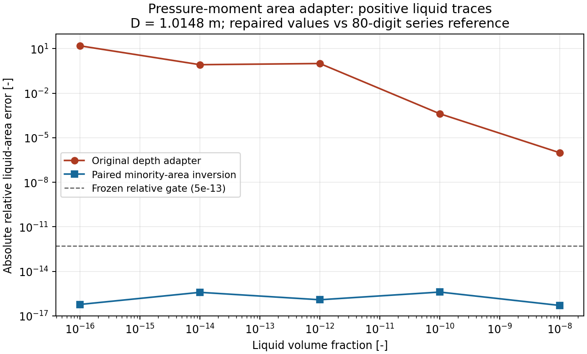

# Stratified pressure-moment coupling: analytical operator record

This record qualifies the default-off coupling of the existing public circular-stratified
pressure moments into `TwoFluidConservationEquations` momentum traction and total-energy work.
The published remote base is `0ed75c2f10d9030ec8d9270c51e4ade28f5603f8`. Local validation began on
`a049b0c147a7dc27999f4182fe8f7c5041614daa`; the two intervening default-branch commits changed
only plant-layout tooling and top-level compressor navigation, so every source, test, and model
document touched by this record is byte-identical on the published base.

For phase $k$, the independently qualified geometry supplies signed moment $J_k$ in m3 and
area $A_k$ in m2. The operator applies

$$F_k=\rho_k g\cos(\theta)J_k\quad[\mathrm N],\qquad
  \dot W_k=\frac{\dot m_k}{\rho_{k,donor}}\frac{F_k}{A_k}\quad[\mathrm W].$$

The work uses the exact signed mass donor selected by advection. The thermodynamic pressure is
the interface pressure. The reference is analytical geometry and finite-volume conservation;
it is not a proprietary trace or fitted dataset.

## Frozen acceptance matrix

`StratifiedPressureMomentCouplingTest` now executes nine tests (the original six plus trace, countercurrent and recovered-volume controls below):

| Gate | Control | Acceptance |
| --- | --- | --- |
| Traction and work | Uniform 40% gas / 60% oil at -2 and +2 m/s | Every inlet/internal/outlet force matches `rho*g*J`; enabled-minus-disabled energy flow matches `velocity*(Fg+Fl)` within 1e-7 W |
| Conservation | Three closed cells at 20/50/80% oil | Length-integrated phase momentum rate equals inlet force minus outlet force within 1e-8 N; mass and stationary energy rates are zero |
| Phase limits | All gas, all oil, all water; vertical mixed section | Present-phase full-section moment matches `+/-rho*g*pi*D^3/8`; absent phases are exactly zero; normal-gravity control is below 1e-11 N |
| Model boundary | Gas/oil/water and a diameter step | Both reject explicitly; no second interface or face geometry is invented |
| Transaction | Valid and rejected trial evaluations | Accepted force ledger is restored bit for bit |
| Compatibility/API | Disable after one enabled evaluation; `TwoFluidPipe` switch | Disabled rates return bit for bit; force ledger becomes empty; public state is explicit and default false |
| Trace traction | Gas or oil fraction 1e-12, 1e-16 and 1e-30 | Minority force divided by the analytical small-segment limit differs from one by at most 3e-8; absent water stays exactly zero |
| Recovered volume | Nonnegative occupied-volume weights within the existing 1e-10 closure bound | Geometric fractions alone use weights divided by their sum; exact single-phase traction and unchanged stored state; 1e-6 closure error still rejects |
| Countercurrent work | Gas/oil opposite directions, nonuniform holdup and unequal densities; both liquid transport modes | Enabled-minus-disabled internal energy flow agrees with the independently signed donor-volume work within 1e-7 W; mass transport is bitwise unchanged |

The focused command passed all six tests on the working tree above that exact base:

```bash
./mvnw -q -Dtest=StratifiedPressureMomentCouplingTest test
```

The disabled branch returns before geometry evaluation and allocates no force-face arrays. The
existing retained geometry timing bounds only the explicit moment query; no end-to-end timestep
speed claim is made. Broader test, formatting, documentation and hook results belong in the PR
ledger and exact-head CI because those results can change with the final published tree.

## Trace-area adapter repair

On unmodified PR head `3dbfef974a2e8d50ce59f44030b2c5dad0f7ad4b`, the old
`calculateFromHoldup` adapter supplies a depth floor of 1e-10 m and an absolute area tolerance.
It therefore passes an incorrect area into the otherwise independently qualified moment integral.
At D = 1.0148 m, the read-only reproducer retained in `holdup-adapter-before.csv` gives:

| Requested liquid fraction | Recovered fraction | Relative area error |
| --- | --- | --- |
| 1e-16 | 1.66065022018e-15 | +1560.6502% |
| 1e-14 | 1.66065022018e-15 | -83.3935% |
| 1e-12 | 1.66065022018e-15 | -99.8339% |

The new trace-force regression fails on that head: measured/analytical limiting force is
`2.3287897398171062e-5` instead of one for liquid fraction 1e-12. This is a geometry-to-operator
adapter defect, distinct from the already-merged explicit-drag repair in #4678. No phase inventory
is changed by either the original geometry query or this repair.



The plot compares area accuracy only. It contains no liquid-pool or evaporation-time result.
`plot_holdup.py` reproduces it from the retained CSV files with Matplotlib.

The operator now uses the paired API
`GeometryCalculator.calculateStratifiedPressureMomentsFromHoldups(gas, liquid, diameter)`.
A safeguarded Newton iteration inverts the minority segment's positive quadrature with relative
area accuracy; gas-minority results are reflected algebraically without subtracting trace depth
from D. Both fractions are retained even when the majority fraction rounds to one. Exact absence
still yields exact zero force/area; unrepresentable geometry rejects. The historical general-purpose
holdup geometry and the default-off operator path are unchanged.

The moment-enabled historical ramp also exposed valid recovered gas volume weights
`1.0000000000000013` (12 cells) and `1.0000000000000027` (24 cells). The original per-fraction
guard rejected both first intervals and restored the primary state. The adapter now validates
nonnegative finite weights and their sum against the unchanged 1e-10 volume-closure bound, then
uses weights divided by that sum for geometry only. Stored holdups and all conservative variables
remain unchanged; no EOS/Jacobian tolerance or mass/momentum clipping is involved. The paired
public geometry API continues to require fractions in [0,1].

### Independent reference and replay

`qualify_holdup.py` compiles the current geometry and native probe with Java 8 API compatibility,
then compares all 162 fixed identities against 80-digit Decimal integration of the binomial series
for the circular chord. It independently inverts that series, with pi from Machin's formula.
The retained matrix spans D = 0.001/0.01/0.2/1.0148/3/10 m, both exact endpoints, half-full and
both positive minority fractions from 1e-30 to 0.25. Every row, order, finite value and exact absence
is checked explicitly, including under optimized Python. Frozen relative acceptance is 5e-13 for
every nonzero area and moment; zero values require exact equality. Refinement uses 120/180 terms.

Results: maximum relative error **1.20312e-14**; maximum unit-section series-refinement difference
**1.84754e-42**. `holdup-native.csv`, `holdup-reference.csv` and `holdup-summary.json` retain all
outputs, the source-parent SHA and the exact geometry blob. JUnit replays all 162 references.
The existing 222 depth-input controls remain byte-identical after the class extension; their strict
source guard was repinned to the formatted class blob, with normal/-O corruption controls retained.

Run from the repository root, after the documented Maven bootstrap:

```bash
python3 src/test/resources/neqsim/process/equipment/pipeline/hydrostatic-pressure-moments/coupling/qualify_holdup.py
./mvnw -q -Dtest=StratifiedPressureMomentCouplingTest,StratifiedPressureMomentsTest test
python3 src/test/resources/neqsim/process/equipment/pipeline/hydrostatic-pressure-moments/coupling/qualify_runtime.py
```

All 16 focused tests and the proportionate 150-test/24-class geometry, phase-appearance, drag,
component, boundary and energy suite pass. The historical 12/24-cell 120 s rich-gas ramp is separately
replayed; its source identity and outcome are recorded in `holdup-validation.json`. This prescribed
pressure regression is not a physical receiver/valve, retained-pool or inlet-refill qualification.

## Enabled transient gate: FAIL

The pressure-moment switch is explicitly enabled by `qualify_ramp.py`, using the existing public
rich-gas test fixture and solver rather than a separate model. After the trace/roundoff repair:

| Mesh | Interval | Last accepted time | Rejected requested time | Diagnostic face-volume sum |
| --- | --- | --- | --- | --- |
| 12 cells | 0.25 s | 0.25 s | 0.5 s | 1.0000000001001803 |
| 24 cells | 0.125 s | 0.25 s | 0.375 s | 1.000000000132666 |

The sums were obtained with exception-message-only instrumentation; no expression or decision was
changed. Both exceed the unchanged 1e-10 geometry volume-closure bound. The rejection is in
`calculateStratifiedPressureFace -> calcInterfaceFluxes -> calcRHS -> TimeIntegrator.stepEuler`.
Elapsed time and all seven primary conservative variables restore exactly on both meshes. This
probe does not independently audit every wall/component/cache rollback field; their existing
transaction regressions remain separate evidence.

`optin-ramp.csv` retains all three accepted intervals, including zero oil, P/T/speed bounds and
mass residuals; `optin-ramp-status.txt` retains both failures. The probe exits nonzero when either
requested ramp fails. This is a numerical integration blocker, not a receiver/thermal model or
hydrocarbon-rate finding. A consistent face-geometry/pressure-stage ownership contract is the next
dependency under the same sole PR. Raising the closure tolerance, seeding, clipping, deleting
phases or hiding the incomplete physical interval is not an accepted resolution.

### Runtime interpretation

`qualify_runtime.py` uses the completed focused-test classpath, the existing 24-cell fixture,
1500 warmups per mode, alternating mode order and nine 1000-evaluation samples. Reflection is only
used in fixture setup. `runtime.csv` and `runtime-parent.csv` retain every sample. In this shared
runtime the repaired disabled median is 252.34 us/RHS versus 258.35 us/RHS on the original PR head
(-2.33%, overlapping ranges). Enabled medians are 282.81 versus 292.73 us/RHS. These noisy,
RHS-only observations establish no speedup or complete-timestep performance claim. The repaired
code is only called on explicit opt-in; ordinary calculations retain the same disabled branch.

## Limits

The qualified face has one gas/liquid interface and one constant circular diameter. Simultaneous
positive oil and water and diameter steps are unsupported. This record has no elapsed time,
pool-level history, cooldown, phase-change rate, restart ramp, slug frequency, moving pig, receiver
capacity, field trace or commercial-simulator comparison. It therefore closes a conservative
traction/work prerequisite only and cannot qualify retained pools, severe slugging, restart or
pigging by itself.

## Pressure-stage investigation: coordinate-only candidate rejected

The existing `ConservativeThermodynamicRecovery` owns endpoint volume acceptance at 1e-9
(and passes 2e-9 to `setConservativeEndpoint`). The new geometry assertion at 1e-10 can therefore
reject an already accepted endpoint. A focused diagnostic reproduced that mismatch for a mixed
endpoint scaled by 1+5e-10; conservative variables remained owned by endpoint recovery.

`qualify_stage_ownership.py` compiles an isolated, source-pinned experimental classpath. Its
retained one-line patch replaces the raw unit-sum assertion with a positive finite total and uses
the already implemented relative geometry coordinates. It never edits production source or any
EOS, energy, velocity or endpoint tolerance. **This candidate is rejected, not shipped.**

The first exploratory run advanced the 12-cell case to36s, then rejected at36.25s for oil speed
-479527m/s. The24-cell case completed120s, with49.47t oil and minimum temperature184K. Neither
result is physical pool/evaporation evidence: the adiabatic tau30s fixture remains approximate,
and the two meshes do not both complete. Final retained outputs use the corrected rollback
probe, which compares actual pre-call time rather than nominal requested time minus dt.

A simpler production-head counterexample isolates the fundamental problem without a timestep,
EOS recovery, phase transfer, terrain or volume residual. Two horizontal10m cells at rest have
identical pressure/densities: left gas/oil fractions1/0, right0.4/0.6, D1.0148m. Both ends close.

| Pressure moments | Dry-cell oil mass kg/m | Oil mass rate kg/(m s) | Oil momentum rate N/m | Internal oil traction N |
| --- | ---: | ---: | ---: | ---: |
| Off | 0 | 0 | 0 | 0 |
| On | 0 | 0 | -27.2519251517 | 272.519251517 |

At any positive Euler interval, zero oil mass and finite oil momentum violate the exact absent-phase
contract before thermodynamic recovery. Global force telescoping does not guarantee local phase
admissibility. `DryWetPressureProbe.java` and `dry-wet-pressure.csv` retain this counterexample;
the executable check deliberately verifies that the defect still exists rather than calling it a
passing physics test. The next implementation must resolve pressure traction at a dry/wet phase
front together with conservative phase transport/work in the existing solver. Merely removing or
raising the volume assertion is not a safe fix. Production source and the prior physics gates
remain unchanged in this investigation.
