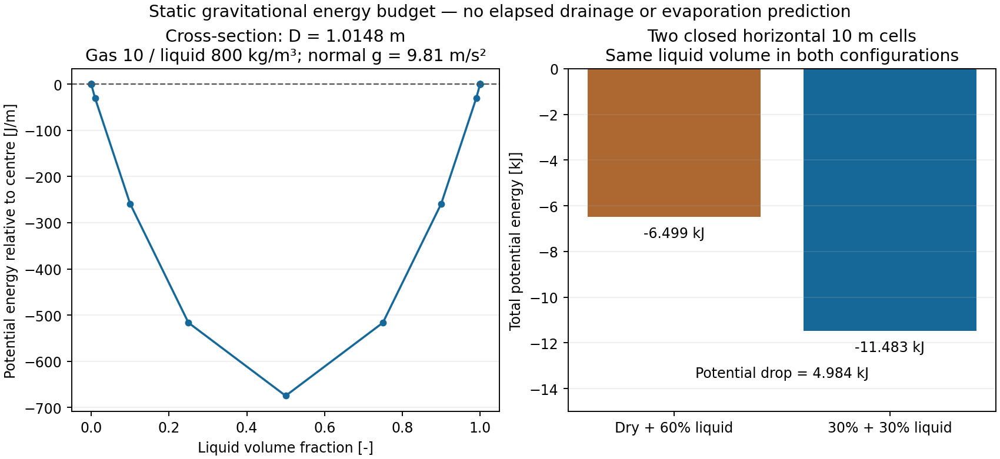

# Centre-referenced cross-sectional gravitational energy

Source base: `98a9e7509391dc0b713e6ea985dc3dc236299f6a`. Exact candidate source blob and
commands/results are retained in `summary.json` and `validation.json`. This is an explicit read-only
API on the existing immutable `GeometryCalculator.StratifiedPressureMoments`, not a new solver.

## Definition, units and ownership

Let y be normal height above the pipe invert, D diameter, h interface depth, A phase area and
J the existing signed pressure moment about the interface. The pipe-centre offset is
`c = (Jl + Jg)/(Al + Ag) = h-D/2`. The new queries return

$$S_l=cA_l-J_l,\qquad S_g=-S_l,\qquad e_{\perp}=(\rho_l-\rho_g)g_{\perp}S_l.$$

Each phase has locally uniform density in one circular stratified cross-section; waves, capillarity
and a second liquid interface are excluded. S is the first area moment about the pipe centre [m3];
normal gravity is g times cosine of
inclination [m/s2]. Energy is per axial length [J/m]. The minority phase is evaluated first,
avoiding subtraction of full-section quantities at both disappearance limits. The other first
moment is its exact negative. No serialized field or UID is added or changed.

The independent closed circular-segment expression is

$$S_l=-\frac23[h(D-h)]^{3/2},\qquad S_g=-S_l.$$

An absent phase has zero moment and its density is unused. Present-phase densities must be finite
and positive; gravity finite. Invalid/overflowing queries reject. Equal densities and zero normal
gravity give exactly zero energy. Negative energy is relative to the declared pipe-centre datum;
it is not negative internal energy. Centreline-elevation, EOS internal, phase kinetic and wall
energy remain separate owners. No transient force/recovery/transfer call site is added here.

## Frozen controls and executed evidence

- 162 independent 80-digit circular-segment references, inherited from the existing 180-term
  binomial-series integration/inversion, span six diameters0.001–10m, both exact phase limits
  and gas/liquid fractions down to1e-30. Algebraic reference conversion is done at80digits.
- Every identity, order, finite output and exact zero is checked. Nonzero first moments and
  energies must agree within **5e-13 relative**, without an absolute full-pipe allowance that
  could hide trace errors. Maximum observed relative error: **7.08712e-15**.
- JUnit additionally checks the closed segment formula, area-moment complement, density/gravity
  limits, invalid inputs/overflow, height derivative (1e-7 relative), volume-preserving static
  redistribution, query purity and four-field/UID1000 serialization.
- `SerializationProbe.java` is compiled separately with the original and extended geometry.
  Their canonical serialized bytes are identical; the digest and recipe are retained.
- The first closed-form test used `1 - depth/D` at a thin gas cap and lost input precision.
  It was corrected to use the actual supplied double depth and `min(depth,D-depth)`, without
  changing the production query or its tolerance. The independent162-row reference already passed.

Run from the repository root after Maven bootstrap:

```bash
python3 src/test/resources/neqsim/process/equipment/pipeline/hydrostatic-pressure-moments/gravity-energy/qualify.py
python3 -m unittest discover -s src/test/resources/neqsim/process/equipment/pipeline/hydrostatic-pressure-moments/gravity-energy -p test_energy_receipts.py -v
./mvnw -q -Dtest=StratifiedGravityEnergyTest,StratifiedPressureMomentsTest,StratifiedPressureMomentCouplingTest,HydrostaticCellGeometryTest test
```

`reference.csv` and `native.csv` retain all162 rows. The standard-library qualifier also runs with
optimized Python; no assertion owns an acceptance gate. `timing.csv` has seven200000-query samples
after100000warmups, cycling all162 immutable objects. Query cost is observational and includes
selection/checksum work; it establishes no whole-simulation speedup. Ordinary calculations gain
no new computation because these methods run only when explicitly called.

### Complete static-budget and timing receipts

The qualifier at parent `9b9c784a77f9ed76b42f8640423e7e1756a0c347` checked the162-row native
matrix but did not audit the static two-cell file and accepted incomplete or nonfinite timing data.
A replay with the valid native matrix, one all-NaN timing row and an all-NaN budget incorrectly
emitted a success summary containing JSON NaN. This was an evidence-reader defect; the retained
valid numerical files and production geometry are unchanged.

The qualifier now requires the exact ordered schema, row/column counts and finite numbers for
every artifact. Seven timing rounds must each contain 200000 queries with positive elapsed time.
The accumulated checksum is compared with an exact rational sum of the retained double energies,
including 100000 warmup additions and a fresh cyclic index for each timing loop. The standard
sequential-rounding bound is `gamma_n * sum(abs(x_i))`, with `gamma_n = n*u/(1-n*u)` and
`u = 2^-53`; this is a checksum roundoff bound, not a relaxed engineering tolerance. No timing
speed threshold is imposed.

The three static energies are independently evaluated using the existing pinned 80-digit segment
series/inversion in `coupling/qualify_holdup.py`, with the original **5e-13 relative** gate.
`budget-reference.csv` retains these references; the maximum relative difference is
**8.77382e-16**. The geometric reference, native and two-cell numerical CSVs reproduce byte for
byte in normal/optimized Python and match the previously retained files. Timing observations
naturally vary; no performance improvement is inferred.

`test_energy_receipts.py` rejects **211 corrupted receipts** per Python mode (108 native,
24 static-budget, 79 timing), including malformed, extra, missing, repeated or reordered fields,
nonfinite values, false work counts, invalid elapsed times, unfunded checksums and changed
energies. Four real compiled-probe mutations reject at the CLI boundary: truncated timing,
NaN budget, altered potential drop and altered native identity. A failed replay removes any
stale success summary. These tests run normally and with `-O`; hosted jobs cover Python 3.11/3.13.
The final candidate's hosted conclusions remain separate from local evidence.

Use `--output-dir <directory>` for an isolated replay without replacing the retained observations.
Repeat the test command above with `python3 -O` to test optimized Python. The executed commands,
source identities, local results and baseline fault injection are in `receipt-validation.json`.
No solver, source, force, energy variable, public API or model threshold is changed by this repair.

## Static two-cell energy bound

Two horizontal10m cells, D1.0148m, gas/liquid densities10/800kg/m3 and normal gravity9.81m/s2
are compared at equal total liquid volume. The initial fractions are0/0.6 and the second
configuration0.3/0.3. These are analytical configurations, not imposed simulated pool locations.

| Configuration | Total potential energy relative to centres |
| --- | ---: |
| Dry + 60% liquid | -6498.944858317336 J |
| 30% + 30% liquid | -11482.95583312998 J |
| Potential drop | 4984.010974812643 J |



The figure was rendered from retained CSVs with Matplotlib and visually inspected. `plot.py`
reproduces it. The finite potential drop illustrates an energy reservoir relevant to liquid
redistribution. It does not supply an interfacial transport rate, interface temperature, heat
supply or elapsed drainage/depletion time.

## Remaining engineering gates

The merged #4791 dry/wet counterexample still gives finite oil momentum to a massless dry cell;
this API does not fix it. Pressure/phase transport/work must be made locally admissible in the
existing solver, with consistent gravitational/internal/kinetic energy ownership and full-interval
rollback. The enabled historical ramp is still unqualified. No pool retention, physical receiver,
same-gas inlet refill/hold, entrainment, multicomponent evaporation closure or predictive depletion
claim follows. #4674/#4675/#3298 remain open. No thermodynamic reference value was used to fit a
transient result.
