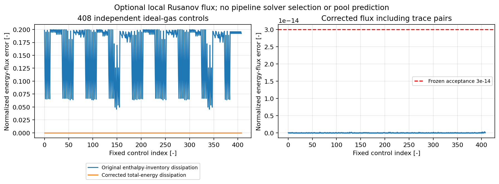

# Conservative total energy in the existing optional Rusanov phase flux

Base: `5d0edbdf6f9e75a89f8f7337b4769d8cb24b2694`. The exact candidate source blob,
commands, local runtimes and qualification limits are retained in `summary.json` and
`validation.json`. This repairs the existing public local flux query; the production pipeline
continues to use its existing AUSM path. No Riemann solver, topology or transaction owner is added.

## Equation and root cause

For phase fraction alpha, density rho, velocity u, pressure p and total specific enthalpy H,
the conserved variables per pipe volume are

$$U=(\alpha\rho,\ \alpha\rho u,\ \alpha(\rho H-p)),$$

and the physical axial flux per pipe area is

$$F=(\alpha\rho u,\ \alpha\rho u^2+\alpha p,\ \alpha\rho uH).$$

H includes phase kinetic energy. The optional local Rusanov flux is

$$F^*=A\left[\frac{F_L+F_R}{2}-\frac{s}{2}(U_R-U_L)\right],\qquad s=\max(|u_L|+c_L,|u_R|+c_R).$$

A is pipe area [m2], c phase sound speed [m/s]. The returned mass, momentum and energy flows
are kg/s, N and W. Original source blob `00afdfdc8a3e32ca722c8fc9fc0b62db5569c9f7`
incorrectly used alpha*rho*H in the dissipative energy inventory. The physical advected enthalpy
flux was already correct. The fix subtracts alpha*p only from the conserved energy jump.

The Euler energy/enthalpy relation is independently described by
[Clawpack's Euler derivation](https://www.clawpack.org/riemann_book/html/Euler_approximate.html).
The local Lax/Rusanov conserved-state jump is given in
[Hakim's numerical-flux note](https://ammar-hakim.org/hancock-muscl.html).
These support the local conservation-law formula, not a new two-fluid pooling qualification.

## Executed pressure-jump regression

Gamma1.4 ideal gas; rho10kg/m3, velocity0, alpha0.5 on both sides, A1m2;
pL1MPa, pR2MPa, c computed from sqrt(gamma*p/rho), H=3.5*p/rho.
All inputs are declared ideal-gas states; this is a numerical-flux identity, not an equilibrium state.

| Energy flux | W |
| --- | ---: |
| Independent conserved-E reference | -330718913.88307387 |
| Original enthalpy-inventory result | -463006479.4363034 |
| Original error | -132287565.55322951 |
| Corrected result | -330718913.88307387 |

The original magnitude error is40%. This instantaneous numerical flux is not an actual heat
duty or a simulated pressure-jump duration. `PressureJump.java` and before/after CSVs retain
the standalone reproduction. The original source also fails the complete independent gate at row0.

## Frozen matrix and independent reference

`qualify.py` constructs384 fixed ideal-gas pairs over rho1/800kg/m3, p0.1/15MPa,
both velocity signs, two pipe areas and fractions1e-30/0.25/1.0. A further24 controls retain
positive traces in both states down to1e-30. Total: **408 complete ordered controls**.
The80-digit Decimal reference builds conserved energy directly as
alpha*(p/(gamma-1)+rho*u*u/2), independently of the implemented rho*H-p conversion.

Frozen acceptance for each flux component is3e-14 times the sum of magnitudes of its physical
fluxes and wave-speed-scaled conserved states. Holdup and pressure metadata use their corresponding
homogeneous scales; there is no absolute full-pipe allowance that could hide a trace result.
The native schema, all408 identities, complete row/column counts and every finite field are checked.
Exact-zero scale requires exact agreement. No Python assertion owns an acceptance gate.

Maximum observed normalized error: **2.63970e-16**. Full input/native/reference matrices are retained.
Normal and optimized Python reproduce identical numerical files. The default-AUSM408-row
output is byte-identical before/after the repair. No runtime solver-selection call was changed.

JUnit additionally checks exact absence with unused NaN extensions, positive traces, identical-state
Euler consistency, signed flow, total-enthalpy kinetic energy, negative reference-energy shifts,
finite guards/overflow, and the explicit Courant condition for an analytical mass-positivity control.
The original false unconditional-stability claim has been removed.

Run from the repository root after the work-with-neqsim Maven bootstrap:

```bash
python3 src/test/resources/neqsim/process/equipment/pipeline/rusanov-total-energy/qualify.py
python3 -O src/test/resources/neqsim/process/equipment/pipeline/rusanov-total-energy/qualify.py --output-dir target/rusanov-optimized
./mvnw -q -Dtest=RusanovConservativeFluxTest test
```

`--source` accepts an explicitly selected Java source for a baseline replay. Preserve its reported
blob; an arbitrary local source must not be labeled as master. The baseline native/control files
are retained separately. `plot.py` reproduces the following figure from the stored results.



## Public output and applicability

`interfaceHoldup` is the arithmetic mean fraction. `interfacePressure` is phase-area weighted,
so their product reproduces the centered pressure traction. `holdupFlux` is the corresponding
local Lax phase-fraction flux. Both absent phases give exact zero without reading unused fields.
Positive occupied density must be finite/positive; velocity, pressure, total enthalpy and sound
speed must be finite, with nonnegative sound speed. Area must be finite/positive. Unrepresentable
interface holdup and nonfinite computed outputs reject; tested traces extend to1e-30.
No state is clipped, seeded or thermodynamically recovered by this query. No serialized field or UID changes.

## Performance and remaining engineering gates

`FluxTiming.java` retains seven200000-query observations after100000 warmups, separately for
baseline/candidate AUSM and Rusanov in independent JVMs. Raw timing/checksum CSVs and observed
min/median/max are retained. Shared-runtime observations are not a whole-simulation speedup claim.
The normal AUSM implementation has no added arithmetic or branches, and its control data are unchanged.
The repaired optional query includes validation and output metadata; do not equate its cost with
ordinary pipeline calculation cost.

Rusanov's two-sided numerical diffusion does not satisfy the existing one-donor component ledger
merely by substituting a net mass flux. No automatic fallback or solver switch is enabled here.
Explicit time integration needs an appropriate Courant bound, admissible EOS states and independent
coupled positivity/energy/rollback evidence. A two-phase volume constraint, normal-gravity pressure
reconstruction and gravitational/internal/kinetic energy ownership still need a coherent integration.

The documented dry/wet unfunded pressure impulse therefore remains unresolved. No elapsed terrain
retention, pool level/inventory, gas-over-pool motion, same-feed inlet refill or physical evaporation
time is demonstrated by this repair. No thermodynamic-reference value was used to tune it.
#4674/#4675/#3298 remain open. This prerequisite stops at the existing local-flux API boundary.

## Final local validation

78 tests across13 classes pass, including6 new Rusanov tests; zero failures/errors/skips.
The unchanged public12/24-cell default-AUSM120s ramp completes with its original per-interval
mass/component/energy assertions (65.946266521s wall on the shared runtime). This is not an
enabled pressure-moment or retained-pool result.

Observed baseline/candidate median local-query times: AUSM31.42/44.02ns; Rusanov25.38/40.95ns.
Sample ranges overlap for AUSM; these shared-runtime measurements do not resolve a speed change.
The optional Rusanov query performs additional validation/metadata work. No Rusanov call was
added to ordinary calculations, and the default408-row numerical output/checksums are unchanged.

Maven helper, stable direct formatting, full Javadoc, documentation search828Markdown+1HTML,
source-generated inventory and all-file pre-commit/pre-push pass. LocalJava17.0.20/Python3.12.14;
Java8 API compilation passes, but no localJava8 JVM or full-repository suite is claimed.
`validation.json` retains command exits, provenance, complete timing samples and limits.
