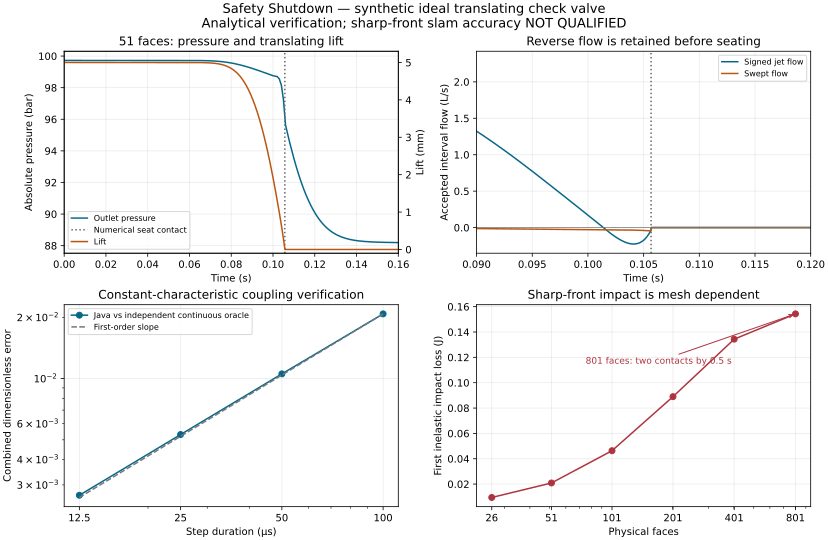

# Safety Shutdown — ideal translating check-valve verification

**Experimental ideal model. Sharp-front slam accuracy is not qualified.** This
batch adds signed jet/swept acoustic coupling and inelastic translating mechanics;
it does not complete SS-02 or the integrated Safety Shutdown campaign.

The reproduced unmodified baseline is `a01d663990a8f43de366a8c02f1ea6280b61c143`.
The publication base is `fd3d28142b2139691ce606e4cba5ab8241469486`, adopted after
disjoint diagnostic-only #4744 merged; production main sources are unchanged. Contracts and
pre-evaluation tolerances are recorded in [#4707 comment6523836074](https://github.com/equinor/neqsim/issues/4707#issuecomment-6523836074)
and the [additional independent/refinement contract](https://github.com/equinor/neqsim/issues/4707#issuecomment-6523980161).
The [water-hammer guide](../../../../../../../docs/wiki/water_hammer_implementation.md#safety-shutdown-ideal-translating-check-valve)
defines equations, units, initialization, APIs, JSON, numerical contact and limits.

## Fixed synthetic case

Water, SRK/classic, 298.15 K, initial inlet 100 bara; actual EOS density
1003.6747533856451 kg/m³. Physical route length 100 m, diameter 0.05 m,
roughness 1e-5 m, effective acoustic speed 1000 m/s. Initial actual flow
0.0022938861707980725 m³/s and independent receiver 98.72334844532102 bara
satisfy both orifice flow and static force at 5 mm lift. Declared mass 0.2 kg,
damping 2 N s/m, stiffness 2000 N/m, preload 0 N, equal pressure/swept area 1e-4 m²,
discharge coefficient 0.65, orifice width 0.05 m, upper stop 10 mm.

The feed is the initial steady state; upstream CLOSED_END applies inlet isolation
at time zero. Duration 0.5 s. This is a prescribed inlet boundary switch, not a
pump-trip, detection/logic test or measured valve. No parameter was fitted.

## Executed results

| Evidence | Classification | Result / limit |
| --- | --- | --- |
| Unmodified master limitation | PASS reproduction | Forward-only legacy valve rejects reverse flow at requested interval 0.1010–0.1011 s. Its declared boundary behavior remains unchanged. |
| Mechanical force-step oracle | PASS | Independent SciPy/expm reference; error ratios 1.951/1.975/1.988 for four halved BE steps, unchanged target ≥1.7. |
| Stiff / large inertia | PASS | m=1e-12 kg reaches 0.01 m with velocity below 1e-10 m/s; m=1e9 kg suppresses motion. |
| Signed pressure work | PASS | 45 pressure/lift/velocity combinations; reciprocal swept flow retained, signed jet is passive. |
| Continuous coupled oracle | PASS | Independent DOP853/Brent seat time 0.016061492246790415 s, preimpact velocity −0.49872262825416125 m/s, impact 0.02487242599327383 J, total reverse volume −3.0503473226212425e-6 m³. Java error reduction≈2 per halving. |
| Constant-acceleration contact | PASS refinement | Numerical time error 4.95e-4→2.49e-4→1.25e-4 s, not an event-exact continuous solution. |
| 51-face isolation, dt 1e-4 s | PASS execution | Reverse jet before seating; contact 0.10566845116269626 s, minimum pre-seat jet −2.258719993853125e-4 m³/s. |
| Declared work / acoustic balances | PASS | Maximum residuals over the frozen cases below 1e-10 J,1e-9 m³ and1e-7 kg m/s; raw rows retain actual values, numerical loss is separate. |
| Local rejection / restart | PASS | Rejected interval preserves accepted cells/disc/clock/work/history. Bit-identical serialized replay crosses contact and retains full requested remainder. This is not global rollback. |
| Sharp-front mesh accuracy | **FAIL evidence gate / not qualified** | First impact grows 0.00945→0.02089→0.04634→0.08899→0.13437→0.15431 J for 26/51/101/201/401/801 faces.801 faces resolves reopening and a second contact at 0.328859 s; coarser meshes miss it. No mesh-independent slam/support load is claimed; no experimental accuracy tolerance was fitted. |
| Full trip / vendor / asset / integrated Safety Shutdown | NOT_EVALUATED | No stopped/reverse pump curve, vendor disc/flow-force/added-mass, cavity collapse, structural support, SIL/SRS/proof-test or plant qualification. |

`time-refinement.json` retains the same 51-face case at 2e-4/1e-4/5e-5 s:
contact 0.1057632202/0.1056684512/0.1056245817 s. `nearby.json` retains all four
mass 0.05/0.8 kg × damping 0/10 N s/m combinations. Mesh and time effects are
reported separately. The pressure envelope can appear nearly stable while the
contact energy and later reopening are still mesh dependent.

`runtime.json` measures the 13 coupled cases in the same warmed JUnit process,
including EOS fixture creation and outlet updates; it excludes JVM/build startup.
It is environment-specific evidence, not a performance regression threshold.

## Files and reproduction

- `public-input.json`, `public-output.json.gz`: complete executed facade example;
 501 aligned outer samples and 5001 accepted internal lift intervals, with exact
 contact points. Gzip retains the complete JSON without dropping rows; the plot
 reader handles it directly. Column names carry units; jet/swept flow are interval fluxes,
 velocity is the post-contact endpoint value. Sparse traces are not inventory.
- `mesh-refinement.json`, `finer-mesh-diagnostic.json`, `time-refinement.json`,
 `nearby.json`: all executed rows, including unresolved contact/mesh behavior.
- `mechanical-refinement.json`, `contact-refinement.json`,
 `coupled-characteristic-refinement.json`, `coupled-oracle.json`: independent
 comparisons and numerical refinement; no reference is calibrated to Java.
- `independent_continuous.py`: continuous DOP853/Brent oracle with terminal seat
 event; run with Python3.12.14/SciPy1.17.0. Zero orifice area only extends rejected
 solver stages below the terminal event; no such stage is retained as physical.
- `independent_energy_prerequisite.py`, `independent-energy-results.json`,
 `signed-power.csv`: unchanged earlier benchmark from comment6519878302. Its
 historical production-coupling NOT_EVALUATED flag is preserved. The omitted-
 swept-flow energy **FAIL** (0.16498015536 J) and midpoint stiff-velocity **FAIL**
 remain visible; a passing BE control did not erase them. The CSV is stored with
 repository LF endings; its original CRLF digest remains in provenance.
- `unmodified-master-reproducer.txt`, `unmodified-master-rejection.json`: exact
 standalone Java source and result executed before feature edits. The source
 is a raw reproducibility record, not an additional runtime API.
- `initial-guard-test-failure.txt.gz`: initial fixture incorrectly expected a finite
 high backpressure to reject. The corrected guard uses an unrepresentable Pa
 conversion; no finite hydraulic case or tolerance was changed.
- `initial-history-schema-failure.txt.gz`: an intermediate candidate declared 12
 history columns while still writing 10; regression caught and fixed it. Final
 public tests assert every row/column count. This log is not final test status.
- `plot_evidence.py`, `validation.svg`: deterministic figure from retained JSON;
 rendered PNG inspected for labels, units, legends and clipping.
- `provenance.json`: source/data hashes, versions, commands, exits and limits.

After the required Maven bootstrap, run the repository JUnit class
`AcousticLiftCheckValveTest` through the normal Maven test goal. It writes complete
raw results under `target/safety-shutdown-lift`. Run the two retained Python
oracles separately; the energy prerequisite takes an output-directory argument.
The plot script reads the retained JSON next to itself and recreates the SVG.

## Primary references and interpretation

The independent numerical reference uses the documented
[SciPy initial-value/event solver](https://docs.scipy.org/doc/scipy/reference/generated/scipy.integrate.solve_ivp.html)
with DOP853, Brent pressure roots and a downward terminal seat event. Its two
independent maximum-step runs agree within the frozen oracle tolerances. This
is verification of the stated ideal equations, not experimental validation.

Knutson and Van de Ven (2016), DOI
[10.1080/14399776.2016.1160718](https://doi.org/10.1080/14399776.2016.1160718),
is a primary example of a more detailed hydraulic check-valve model and measured
lift comparison. Its hydrodynamic/contact details and measured parameters were
not copied, fitted or used to claim pipeline-slam qualification here. Real valve
geometry, force correlations, added mass and contact behavior need separate data
and validation. NRC-4707 remains PROPOSED; executed tests do not record its approval.

`unrepresentable-interval-reproduction.txt.gz` retains the failing regression for
a finite-parameter implicit-denominator overflow. The corrected interval wrapper
converts this local numerical rejection to the study's structured last-accepted
state report. `unrepresentable-boundary-rejected.json` retains the executed error
with zero accepted time/work; it is an expected rejection, not a completed case.
